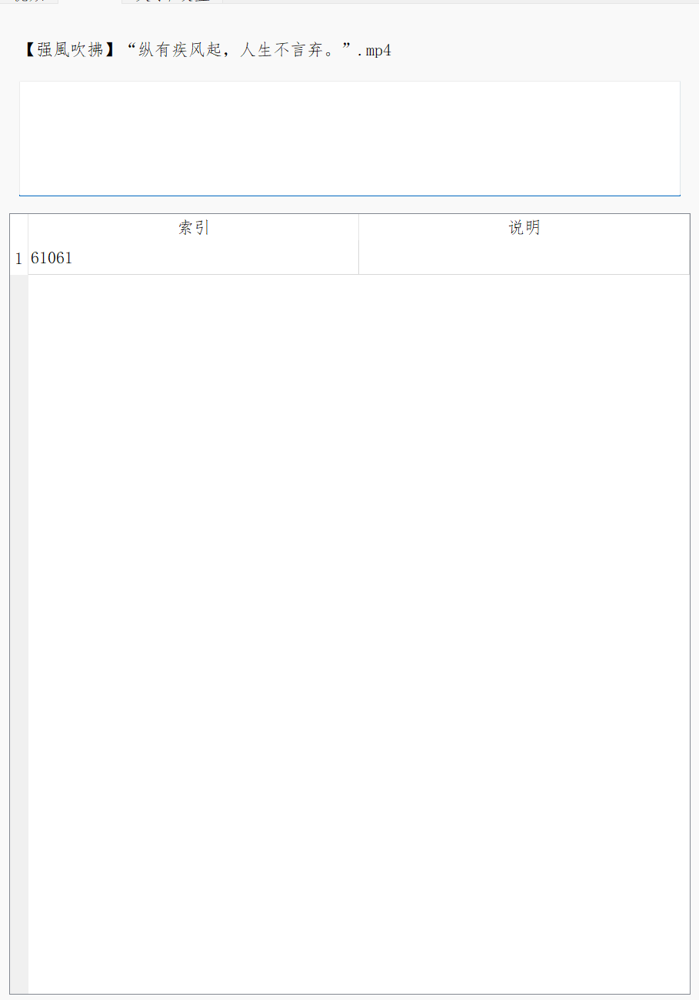
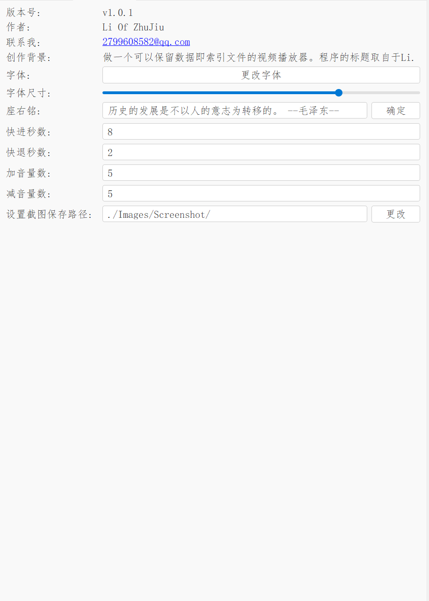

# 满城桃李 - 视频播放器

> 一个可以保留数据（索引文件）的视频播放器，基于 PySide6 + Qt Multimedia 构建。

## 项目简介

满城桃李是一个桌面端（Windows 10/11）视频播放器，支持视频播放、索引标记、截图、倍速播放等功能。

与普通播放器最大的区别：**它以视频文件指纹为键，持久化保存每个视频的「简介」和「索引时间点」**。学到哪个知识点、看到哪句台词，按一个键就能标记下来，下次打开该视频时自动恢复，时间点双击即可跳转。

## 功能展示

### 视频播放与控制


- 支持 MP4、AVI、MKV、MOV 格式（可手动设置）
- 播放/暂停、重播、快进/快退（±10 秒）
- 可点击进度条跳转、键盘快捷键控制
- 支持多倍速播放（0.25x ~ 3x，可手动设置）
- 播放引擎为 Qt Multimedia，音视频同引擎同步，4K 视频走 GPU 渲染

### 视频列表管理


- 双击空白区域添加视频
- 双击视频名称播放
- 右键菜单删除视频
- 支持拖拽排序
- 程序关闭时自动保存播放列表，下次启动自动恢复

### 索引与简介



- 为视频添加简介文本
- 按 `M` 键在当前位置添加索引标记
- 双击索引行的时间列可跳转到对应位置
- 按 `S` 键或切换视频时自动保存索引数据
- 索引数据以视频文件指纹（SHA-256）为文件名独立存储

### 截图功能

- 点击截图按钮保存当前视频帧
- 截图按视频指纹分目录存储
- 截图保存路径可在设置中自定义

### 设置页面



- 自定义字体及字体大小
- 调整快进/快退秒数
- 调整音量增减幅度
- 设置截图保存路径
- 自定义座右铭
- **自定义背景图片**：可启用一张背景图（仅在未播放视频时显示），支持调整不透明度，图片保持原比例不变形
- 底部常驻快捷键提示

## 快捷键

> 以下快捷键在**播放中或暂停时**生效。

| 按键 | 功能 |
|------|------|
| `空格` | 播放/暂停 |
| `左方向键` | 快退（秒数可在设置中配置） |
| `右方向键` | 快进（秒数可在设置中配置） |
| `上方向键` | 增加音量（幅度可在设置中配置） |
| `下方向键` | 减少音量（幅度可在设置中配置） |
| `M` | 在当前位置添加索引标记 |
| `S` | 保存当前视频的简介和索引数据 |

## 项目结构

```
ManChengTaoLi_1.0.1/
├── Configure/                  # 配置目录（运行时生成）
│   ├── Index/                  # 视频索引文件（按文件指纹命名）
│   ├── Log/                    # 日志
│   ├── program.json            # 程序配置文件
│   └── sequence.json           # 视频播放列表（程序关闭时自动保存）
├── Font/                       # 字体文件目录
├── Images/                     # 图标与截图目录
│   ├── Screenshot/             # 截图保存目录
│   ├── arrow_down.png          # 倍速下拉列表箭头图标
│   ├── Mancheng_Peach_And_Plum_Blossoms.ico  # 程序图标
│   ├── camera.png              # 截图按钮图标
│   ├── delete.png              # 右键菜单删除图标
│   ├── pause.png               # 暂停按钮图标
│   ├── play.png                # 播放按钮图标
│   ├── replay.png              # 重播按钮图标
│   ├── speed_back_10s.png      # 快退按钮图标
│   └── speed_up_10s.png        # 快进按钮图标
├── Markdown_Images/            # README 演示截图
├── HandBook.py                 # 手册框架（QTabWidget，包含视频/索引/设置三个页面）
├── ManChengTaoLi.py            # 主程序入口（主窗口、命令行参数处理、防重复启动）
├── Mutual.py                   # 交互框架（视频显示、播放器、控制台、进度条）
├── index_dir.py                # 索引界面（简介文本、索引表格、视频跳转）
├── initialize.py               # 初始化模块（加载配置、文件指纹、播放逻辑等工具函数）
├── setting_dir.py              # 设置界面（字体、音量、快进快退秒数、截图路径、背景图等）
├── video_dir.py                # 视频列表（添加/删除/拖拽排序/双击播放）
├── requirements.txt            # Python 依赖
├── README.md                   # 说明文档
└── bug.md                      # 开发过程中遇到的问题与解决记录
```

## 各文件功能与工作流

### 启动流程

```
ManChengTaoLi.py (main)
  ├── 检查程序是否重复运行（psutil）
  ├── 创建 QApplication
  ├── 创建主窗口 TaoLi
  │     ├── 读取 Configure/program.json 配置
  │     ├── 创建 HandBook（左侧标签页）
  │     │     ├── VideoList    → 视频列表页
  │     │     ├── IndexWidget  → 索引页（简介 + 索引表格）
  │     │     └── SettingFrame → 设置页
  │     └── 创建 Mutual（右侧播放区）
  │           ├── VideoPlayer  → 视频播放器（QMediaPlayer + QGraphicsVideoItem）
  │           ├── VideoWidget  → 视频显示 + 居中控制按钮
  │           └── Console      → 底部控制台（进度条、播放/暂停、重播、倍速）
  └── 处理命令行参数（支持双击视频文件直接播放）
```

### 播放引擎架构

```
QMediaPlayer ──┬─→ QAudioOutput                 → 系统音频设备
               └─→ QGraphicsVideoItem            → 图形场景图元（GPU 渲染）
                        │
                   QGraphicsScene                → 背景色 / 背景图片
                        │
                   QGraphicsView                 → 承载场景的普通子控件（铺满 VideoWidget）
```

**为什么用 `QGraphicsView + QGraphicsVideoItem` 而不是官方推荐的 `QVideoWidget`？**

`QVideoWidget` 是**原生窗口**（native window），在 Windows 上它会被系统单独合成，Z 序永远压在所有普通子控件之上——`lower()`、`raise_()`、`stackUnder()` 全都无效。结果是叠加在画面上的截图/±10s/居中按钮被完全盖住（看起来"控件不显示，但鼠标点上去还有反应"）。

`QGraphicsVideoItem` 是普通图元，参与正常的绘制与遮挡，叠加控件可以正常 `raise_()` 到画面上方，同时依然走 GPU 渲染路径（4K 实测 0.97x 实时）。帧数据不进入 Python，没有额外的内存拷贝开销。

### ManChengTaoLi.py - 主程序入口

- `TaoLi`：主窗口类，组装左侧手册框架和右侧交互框架
- `check_running()`：通过 psutil 检测进程，防止重复启动
- `play_external_video()`：处理命令行传入的视频文件路径
- `closeEvent()`：关闭窗口时保存播放列表和配置数据

### initialize.py - 初始化模块

- 加载 `Configure/program.json` 到全局字典 `configure_data`
- 加载 `Configure/sequence.json` 到全局列表 `sequence`
- `fingerprint()`：计算文件 SHA-256 哈希值，用于唯一标识视频
- `add_item()` / `pop_item()`：添加/删除列表项，同时管理文件指纹
- `index_file()`：获取或创建视频索引文件（`Configure/Index/{hash}.json`）
- `play_video_inside()` / `play_video_external()`：播放内部/外部视频
- `set_font()` / `set_size()`：全局字体/字号设置（两者互不覆盖，见 bug.md）

### HandBook.py - 手册框架

- `HandBook`：继承 `QTabWidget`，包含三个标签页：视频列表、索引、关于/设置

### video_dir.py - 视频列表

- `FileHash`：多线程文件哈希，避免添加视频时阻塞 UI
- `VideoList`：继承 `QListWidget`
  - 双击空白区域 → 弹出文件选择对话框添加视频
  - 双击视频名称 → 播放该视频
  - 右键菜单 → 删除视频
  - 支持拖拽排序
  - 启动时自动从 `sequence.json` 恢复上次的播放列表

### index_dir.py - 索引界面

- `IndexWidget`：包含简介框架和索引表格
- `BlurbFrame`：显示视频名称（默认显示座右铭）和简介文本框
- `PointerTable`：索引表格
  - 双击**时间列** → 视频跳转到对应位置
  - 右键菜单 → 删除索引行

### Mutual.py - 交互框架

- `VideoWidget`：视频显示容器
  - 居中播放/暂停按钮、截图按钮、快进/快退按钮
  - 鼠标进入显示控制区，5 秒无操作自动隐藏
  - 键盘快捷键支持
- `VideoPlayer`：视频播放器核心
  - 内部封装 `QMediaPlayer` + `QAudioOutput` + `QGraphicsVideoItem`
  - 音视频由同一引擎驱动，共用一条时间轴，天然同步
  - **平滑位置时钟**：以 `positionChanged` 为校钟点、单调时钟外推，让进度条匀速走动（见 bug.md）
  - 截图功能：用 OpenCV 按当前时间点重新解一帧并保存
  - 背景色/背景图片管理（空闲白底或自定义图片，播放中黑底）
- `Console`：底部控制台
  - 进度条（可点击跳转）、播放/暂停、重播、时长显示、倍速选择
  - `MonoTimeLabel`：等宽字体时长标签，宽度固定，避免每秒重排导致的抖动
- `Progress`：进度条控件，重写点击事件实现视频跳转
- `Mutual`：交互框架，组装 VideoPlayer 和 VideoWidget

### setting_dir.py - 设置界面

- `Slider`：自定义滑块，松开鼠标时应用字号（必须调用 `super().mouseReleaseEvent()`，见 bug.md）
- `SettingFrame`：设置面板
  - 显示版本号、作者、联系方式、创作背景
  - 更改字体、字体大小
  - 调整快进/快退秒数、音量增减幅度
  - 自定义座右铭
  - 设置截图保存路径
  - 自定义背景图片（可折叠分组：启用开关 + 图片选择 + 不透明度）
  - 底部快捷键提示

## 配置文件说明

程序配置文件位于 `Configure/program.json`，使用 JSON 格式存储。

### 基础配置

| 配置项 | 类型 | 说明 |
|--------|------|------|
| `程序名称` | string | 程序窗口标题 |
| `版本号` | string | 当前版本号 |
| `作者` | string | 开发者信息 |
| `联系邮箱` | string | 开发者邮箱 |
| `程序图标` | string | 程序窗口图标路径 |
| `窗口初始大小` | array | 窗口初始宽高，格式 `[宽, 高]` |
| `创作背景` | string | 关于页面展示的创作背景 |
| `名言名句` | string | 默认显示的座右铭 |

### 字体配置

| 配置项 | 类型 | 说明 |
|--------|------|------|
| `字体` | string | 字体文件路径（支持 ttf/otf/ttc） |
| `字体尺寸` | int | 默认字体大小（像素） |
| `字体最大值` | int | 字体大小滑块上限 |
| `字体最小值` | int | 字体大小滑块下限 |
| `字体过滤器` | string | 字体文件选择器的格式过滤 |
| `当前字体系列` | string | 运行时记录：当前生效的字体族（程序自动写入） |
| `当前字号` | int | 运行时记录：当前生效的字号（程序自动写入） |

### 播放配置

| 配置项 | 类型 | 说明 |
|--------|------|------|
| `快进秒数` | int | 右方向键快进秒数 |
| `快退秒数` | int | 左方向键快退秒数 |
| `加音量数` | int | 上方向键增加音量值 |
| `减音量数` | int | 下方向键减少音量值 |
| `倍速` | array | 可选倍速列表，如 `["0.5", "1", "1.5", "2"]` |
| `默认截图保存路径` | string | 截图保存目录（支持相对路径） |

### 背景图片配置

| 配置项 | 类型 | 说明 |
|--------|------|------|
| `启用自定义背景图片` | bool | 是否使用自定义背景图（仅在未播放视频时显示） |
| `背景图片路径` | string | 背景图片路径（支持 png/jpg/jpeg/bmp/webp） |
| `背景图片不透明度` | int | 0-100，背景图的不透明度 |

> 背景图按**保持宽高比 + 平滑缩放**处理：等比缩放到能放进视频区域为止并居中，四周留白。不会拉伸变形，也不会裁掉图片内容。

### 视频格式配置

| 配置项 | 类型 | 说明 |
|--------|------|------|
| `视频过滤器` | string | 文件选择对话框的格式过滤 |
| `可识别格式` | array | 命令行打开时可识别的视频后缀列表 |

### 图标配置（支持用户自定义）

以下图标路径均可手动修改，支持相对路径（相对于程序运行目录）和绝对路径。修改后重启程序即可生效。

| 配置项 | 默认值 | 说明 |
|--------|--------|------|
| `截图按钮图标` | `./Images/camera.png` | 视频区域左侧截图按钮图标 |
| `暂停按钮图标` | `./Images/pause.png` | 暂停状态显示的图标 |
| `播放按钮图标` | `./Images/play.png` | 播放状态显示的图标 |
| `重播按钮图标` | `./Images/replay.png` | 底部控制台重播按钮图标 |
| `快退10s按钮图标` | `./Images/speed_back_10s.png` | 视频区域快退按钮图标 |
| `快进10s按钮图标` | `./Images/speed_up_10s.png` | 视频区域快进按钮图标 |
| `右键菜单栏删除图标` | 自定义路径 | 右键菜单中删除操作的图标 |

> **如何自定义图标：** 打开 `Configure/program.json`，找到对应的配置项，将路径修改为你自己的图标文件路径即可。程序启动时会读取该路径加载图标。如果路径无效，将使用默认路径。

### 内部地址（请勿修改）

以下配置项由程序运行时自动管理，请勿手动修改：

| 配置项 | 说明 |
|--------|------|
| `主程序窗口地址` | 主窗口实例引用 |
| `播放器地址` | 播放器实例引用 |
| `播放列表地址` | 播放列表实例引用 |
| `表格页地址` | 索引表格实例引用 |
| `定时器地址` | 定时器实例引用 |
| `简介框架地址` | 简介框架实例引用 |

## 环境要求

- **Python 3.9+**（开发与测试环境为 3.10.5）
- **Windows 10/11**
- **无需单独安装 ffmpeg**：PySide6 的 Qt Multimedia 已内置 FFmpeg 解码器

### 安装依赖

```bash
pip install -r requirements.txt
```

依赖列表：

| 依赖 | 用途 |
|------|------|
| `PySide6` | GUI 框架 + 音视频播放（内置 Qt Multimedia 与 FFmpeg） |
| `opencv-python` | 截图功能（从视频当前时间点重新解一帧） |
| `psutil` | 进程检测（防止重复启动） |

> `numpy` 是 opencv-python 的传递依赖，会自动安装，无需手动声明。

## 运行

```bash
python ManChengTaoLi.py
```

也支持直接双击视频文件打开（需将程序添加到系统环境变量或设置文件关联）：

```bash
python ManChengTaoLi.py "视频文件路径.mp4"
```

## 数据存储

- **播放列表**：`Configure/sequence.json`，程序关闭时自动保存当前列表顺序
- **视频索引**：`Configure/Index/{文件指纹}.json`，每个视频独立存储简介和索引标记
- **截图**：`Images/Screenshot/{文件指纹}/`，按视频分目录保存
- **日志**：`Configure/Log/{日期}.log`

## 常见问题

**Q：播放 4K 视频卡顿？**
A：当前使用 Qt Multimedia 的 GPU 渲染路径，4K 实测可实时播放。若仍卡顿，检查显卡驱动是否为最新版本。

**Q：设置里的字体改了没效果？**
A：字体与字号是两个独立设置，互不覆盖（旧版本存在此 bug，已在 1.0.1 修复）。选择字体后字号保持不变，反之亦然。

**Q：背景图片不显示？**
A：背景图只在**没有播放视频**时显示。播放中画面区域是黑色的（护眼）。另外请确认图片路径有效。

**Q：进度条看起来一顿一顿的？**
A：进度条使用了平滑位置时钟（以播放器位置信号为校钟点、用单调时钟外推），在正常硬件上应当匀速走动。若在低功耗设备上仍有卡顿，属于系统调度限制。

## 更新日志

### v1.0.1

**播放引擎重构**

- 播放引擎从「OpenCV 读帧 + ffmpeg 抽音 + pygame 播放」整体替换为 Qt Multimedia（`QMediaPlayer` + `QGraphicsVideoItem`）
- 音视频由同一引擎驱动、共用同一条时间轴，从根本上消除了长期存在的音画不同步问题
- 4K 视频改走 GPU 渲染路径，不再出现"画面卡成 PPT"
- 提升采样质量：开启 `SmoothPixmapTransform`，缩放后的画面更平滑

**界面与交互修复**

- 修复视频区域叠加控件（截图/±10s/居中按钮）不显示的问题
- 修复最大化后视频画面被遮挡的问题
- 修复时长标签每秒上下抖动的问题
- 修复进度条更新不实时的问题（平滑位置时钟 + 精确计时器）
- 修复"调整字号后字体变回系统默认"的问题
- 修复滑块松手后仍跟随鼠标移动的问题
- 修复点击视频进度条父控件空白区域触发暂停的问题
- 进度条高度从 6px 调整为 12px，更易点击
- 视频区域背景：空闲时白色（或自定义背景图），播放中黑色

**功能新增**

- 设置界面支持自定义背景图片（含启用开关、图片选择、不透明度调节）
- 设置界面底部新增快捷键提示

**框架迁移**

- 从 PyQt5 完整迁移到 PySide6（LGPL 授权，更适合开源分发）
- 删除不再使用的 `pygame`、`numpy` 直接依赖

### v1.0.0

- 首个版本

## License

MIT
