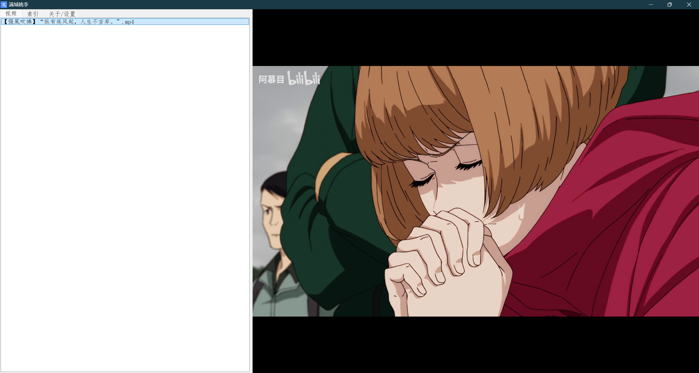

# 满城桃李 - 视频播放器

> 一个可以保留数据（索引文件）的视频播放器，基于 PyQt5 + OpenCV + pygame 构建。

## 项目简介

满城桃李是一个桌面端（Windows10/11+）视频播放器，支持视频播放、索引标记、截图、倍速播放等功能。

## 功能展示

### 视频播放与控制



- 支持 MP4、AVI、MKV、MOV 格式（可手动设置）
- 播放/暂停、重播、快进/快退
- 可点击进度条跳转、键盘快捷键控制
- 支持多倍速播放（0.25x ~ 3x, 可手动设置）

### 视频列表管理


- 双击空白区域添加视频
- 双击视频名称播放
- 右键菜单删除视频
- 支持拖拽排序
- 程序关闭时自动保存播放列表，下次启动自动恢复

### 索引与简介

<!-- 替换为你的截图：Images/demo_index.png -->


- 为视频添加简介文本
- 按 `M` 键在当前位置添加索引标记
- 双击索引行的时间列可跳转到对应位置
- 按 `Ctrl+S` 或切换视频时自动保存索引数据
- 索引数据以视频文件指纹（SHA-256）为文件名独立存储

### 截图功能


- 点击截图按钮保存当前视频帧
- 截图按视频指纹分目录存储
- 截图保存路径可在设置中自定义

### 设置页面


- 自定义字体及字体大小
- 调整快进/快退秒数
- 调整音量增减幅度
- 设置截图保存路径
- 自定义座右铭

## 快捷键

| 按键 | 功能 |
|------|------|
| `空格` | 播放/暂停 |
| `左方向键` | 快退（秒数可在设置中配置） |
| `右方向键` | 快进（秒数可在设置中配置） |
| `上方向键` | 增加音量 |
| `下方向键` | 减少音量 |
| `M` | 在当前位置添加索引标记 |
| `S` | 保存当前视频的简介和索引数据 |

## 项目结构

```
ManChengTaoLi_1.0.1/
├── Configure/                  # 配置目录
│   ├── Index/                  # 视频索引文件（按文件指纹命名）
│   ├── Log/                    # 日志
│   ├── program.json            # 程序配置文件
│   └── sequence.json           # 视频播放列表（程序关闭时自动保存）
├── Images/                     # 图标与截图目录
│   ├── Screenshot/             # 截图保存目录
|   ├── arrow_down.png          # 倍速下拉列表箭头图标
│   ├── Mancheng_Peach_And_Plum_Blossoms.ico  # 程序图标
│   ├── camera.png              # 截图按钮图标
│   ├── delete.png              # 右键菜单删除图标
│   ├── pause.png               # 暂停按钮图标
│   ├── play.png                # 播放按钮图标
│   ├── replay.png              # 重播按钮图标
│   ├── speed_back_10s.png      # 快退按钮图标
│   └── speed_up_10s.png        # 快进按钮图标
├── HandBook.py                 # 手册框架（QTabWidget，包含视频/索引/设置三个页面）
├── ManChengTaoLi.py            # 主程序入口（主窗口、命令行参数处理、防重复启动）
├── Mutual.py                   # 交互框架（视频显示、播放器、控制台、进度条）
├── index_dir.py                # 索引界面（简介文本、索引表格、视频跳转）
├── initialize.py               # 初始化模块（加载配置、文件指纹、播放逻辑等工具函数）
├── setting_dir.py              # 设置界面（字体、音量、快进快退秒数、截图路径等）
├── video_dir.py                # 视频列表（添加/删除/拖拽排序/双击播放）
├── requirements.txt            # Python 依赖
└── README.md                   # 说明文档
```

## 各文件功能与工作流

### 启动流程

```
ManChengTaoLi.py (main)
  ├── 检查程序是否重复运行（psutil）
  ├── 创建 QApplication
  ├── 创建主窗口 TaoLi
  │     ├── 读取 Configure/program.json 配置
  │     ├── 创建 HandBook（左侧标签页）
  │     │     ├── VideoList    → 视频列表页
  │     │     ├── IndexWidget  → 索引页（简介 + 索引表格）
  │     │     └── SettingFrame → 设置页
  │     └── 创建 Mutual（右侧播放区）
  │           ├── VideoPlayer  → 视频播放器（OpenCV 读帧 + pygame 播音频）
  │           ├── VideoWidget  → 视频显示 + 居中控制按钮
  │           └── Console      → 底部控制台（进度条、播放/暂停、重播、倍速）
  └── 处理命令行参数（支持双击视频文件直接播放）
```

### ManChengTaoLi.py - 主程序入口

- `TaoLi`：主窗口类，组装左侧手册框架和右侧交互框架
- `check_running()`：通过 psutil 检测进程，防止重复启动
- `play_external_video()`：处理命令行传入的视频文件路径
- `closeEvent()`：关闭窗口时保存播放列表和配置数据

### initialize.py - 初始化模块

- 加载 `Configure/program.json` 到全局字典 `configure_data`
- 加载 `Configure/sequence.json` 到全局列表 `sequence`
- `fingerprint()`：计算文件 SHA-256 哈希值，用于唯一标识视频
- `add_item()` / `pop_item()`：添加/删除列表项，同时管理文件指纹
- `index_file()`：获取或创建视频索引文件（`Configure/Index/{hash}.json`）
- `play_video_inside()` / `play_video_external()`：播放内部/外部视频
- `set_font()` / `set_size()`：全局字体/字号设置

### HandBook.py - 手册框架

- `HandBook`：继承 `QTabWidget`，包含三个标签页：视频列表、索引、关于/设置

### video_dir.py - 视频列表

- `FileHash`：多线程文件哈希，避免添加视频时阻塞 UI
- `VideoList`：继承 `QListWidget`
  - 双击空白区域 → 弹出文件选择对话框添加视频
  - 双击视频名称 → 播放该视频
  - 右键菜单 → 删除视频
  - 支持拖拽排序
  - 启动时自动从 `sequence.json` 恢复上次的播放列表

### index_dir.py - 索引界面

- `IndexWidget`：包含简介框架和索引表格
- `BlurbFrame`：显示视频名称（默认显示座右铭）和简介文本框
- `PointerTable`：索引表格
  - 双击时间列 → 视频跳转到对应位置
  - 右键菜单 → 删除索引行

### Mutual.py - 交互框架

- `VideoWidget`：视频显示控件
  - 居中播放/暂停按钮、截图按钮、快进/快退按钮
  - 鼠标进入显示控制区，5秒无操作自动隐藏
  - 键盘快捷键支持
- `VideoPlayer`：视频播放器核心
  - OpenCV 读取视频帧，pygame 播放音频
  - 通过 ffmpeg 抽取音频并支持倍速播放
  - 截图功能（保存当前帧到指定目录）
- `Console`：底部控制台
  - 进度条（可点击跳转）、播放/暂停、重播、时长显示、倍速选择
- `Progress`：进度条控件，重写点击事件实现视频跳转
- `Mutual`：交互框架，组装 VideoPlayer 和 VideoWidget

### setting_dir.py - 设置界面

- `Slider`：自定义滑块，松开鼠标时应用字体大小
- `SettingFrame`：设置面板
  - 显示版本号、作者、联系方式、创作背景
  - 更改字体、字体大小
  - 调整快进/快退秒数、音量增减幅度
  - 自定义座右铭
  - 设置截图保存路径

## 配置文件说明

程序配置文件位于 `Configure/program.json`，使用 JSON 格式存储。

### 基础配置

| 配置项 | 类型 | 说明 |
|--------|------|------|
| `程序名称` | string | 程序窗口标题 |
| `版本号` | string | 当前版本号 |
| `作者` | string | 开发者信息 |
| `联系邮箱` | string | 开发者邮箱 |
| `程序图标` | string | 程序窗口图标路径 |
| `窗口初始大小` | array | 窗口初始宽高，格式 `[宽, 高]` |
| `创作背景` | string | 关于页面展示的创作背景 |
| `名言名句` | string | 默认显示的座右铭 |

### 字体配置

| 配置项 | 类型 | 说明 |
|--------|------|------|
| `字体` | string | 字体文件路径（支持 ttf/otf/ttc） |
| `字体尺寸` | int | 默认字体大小（像素） |
| `字体最大值` | int | 字体大小滑块上限 |
| `字体最小值` | int | 字体大小滑块下限 |
| `字体过滤器` | string | 字体文件选择器的格式过滤 |

### 播放配置

| 配置项 | 类型 | 说明 |
|--------|------|------|
| `快进秒数` | int | 右方向键快进秒数 |
| `快退秒数` | int | 左方向键快退秒数 |
| `加音量数` | int | 上方向键增加音量值 |
| `减音量数` | int | 下方向键减少音量值 |
| `倍速` | array | 可选倍速列表，如 `["0.5", "1", "1.5", "2"]` |
| `默认截图保存路径` | string | 截图保存目录（支持相对路径） |

### 视频格式配置

| 配置项 | 类型 | 说明 |
|--------|------|------|
| `视频过滤器` | string | 文件选择对话框的格式过滤 |
| `可识别格式` | array | 命令行打开时可识别的视频后缀列表 |

### 图标配置（支持用户自定义）

以下图标路径均可手动修改，支持相对路径（相对于程序运行目录）和绝对路径。修改后重启程序即可生效。

| 配置项 | 默认值 | 说明 |
|--------|--------|------|
| `截图按钮图标` | `./Images/camera.png` | 视频区域左侧截图按钮图标 |
| `暂停按钮图标` | `./Images/pause.png` | 暂停状态显示的图标 |
| `播放按钮图标` | `./Images/play.png` | 播放状态显示的图标 |
| `重播按钮图标` | `./Images/replay.png` | 底部控制台重播按钮图标 |
| `快退10s按钮图标` | `./Images/speed_back_10s.png` | 视频区域快退按钮图标 |
| `快进10s按钮图标` | `./Images/speed_up_10s.png` | 视频区域快进按钮图标 |
| `右键菜单栏删除图标` | 自定义路径 | 右键菜单中删除操作的图标 |

> **如何自定义图标：** 打开 `Configure/program.json`，找到对应的配置项，将路径修改为你自己的图标文件路径即可。程序启动时会读取该路径加载图标。如果路径无效，将使用默认路径。

### 内部地址（请勿修改）

以下配置项由程序运行时自动管理，请勿手动修改：

| 配置项 | 说明 |
|--------|------|
| `主程序窗口地址` | 主窗口实例引用 |
| `播放器地址` | 播放器实例引用 |
| `播放列表地址` | 播放列表实例引用 |
| `表格页地址` | 索引表格实例引用 |
| `定时器地址` | 定时器实例引用 |
| `简介框架地址` | 简介框架实例引用 |

## 环境要求

- Python 3.9+
- ffmpeg（用于音频抽取，需添加到系统环境变量）

### 安装依赖

```bash
pip install -r requirements.txt
```

依赖列表：
- `PyQt5` - GUI 框架
- `opencv-python` - 视频帧读取
- `numpy` - 图像处理
- `pygame` - 音频播放
- `psutil` - 进程检测（防止重复启动）

## 运行

```bash
python ManChengTaoLi.py
```

也支持直接双击视频文件打开（需将程序添加到系统环境变量或设置文件关联）：

```bash
python ManChengTaoLi.py "视频文件路径.mp4"
```

## 数据存储

- **播放列表**：`Configure/sequence.json`，程序关闭时自动保存当前列表顺序
- **视频索引**：`Configure/Index/{文件指纹}.json`，每个视频独立存储简介和索引标记
- **截图**：`Images/Screenshot/{文件指纹}/`，按视频分目录保存

## License

MIT
